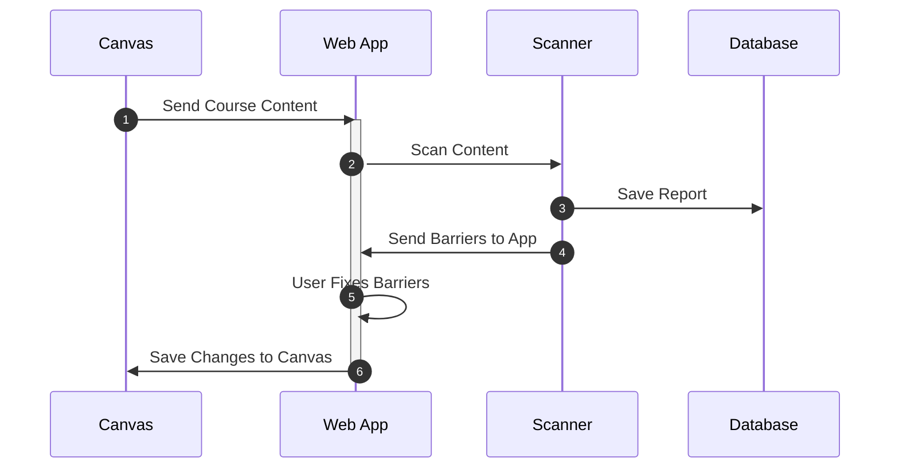

# Universal Design Online content Inspection Tool

UDOIT identifies accessibility issues in Canvas online course content. It will scan an entire course, generate reports, and provide resources to help users quickly address common accessibility issues.

UDOIT was originally developed by the [University of Central Florida](https://www.ucf.edu/) (UCF) in 2014, and is open source and free to use. While it is managed and maintained by [UCF Open](https://ucfopen.github.io/), significant contributions have also been made by [Cidi Labs](https://cidilabs.com/), which also provides commercial hosting services for those who cannot host UDOIT on their own.

## Primary Features

For more details about UDOIT's features, with more complete descriptions and screenshots, visit UCF Open's [UDOIT Website](https://ucfopen.github.io/udoit.info/).

### Upgraded Scanner

* Finds significantly more issue types than UDOIT 3.5.0.
* Accurately identifies the following types of barriers:
  * Page headings not using heading elements
  * Lists not using list markup
  * Insufficient color contrast
  * Color being used for emphasis
  * Images without alt text
  * Tables having incorrect headers
  * Empty headings and links
  * Improper element nesting
  * ... and many, many more!
* Reads and scans the following Canvas course content:
  * Pages
  * Announcements
  * Assignments
  * Discussion Topics
  * Modules
  * Quizzes
  * Syllabus

### Easy-to-Use Remediation Tools

* Every barrier includes a **full page content preview** so the content can be seen in context.
* Allows users to search through barriers and **filter by module**, page name, barrier type, and more.
* Built-in **captioning system** helps users create and edit captions and link them to video and audio files.
* Custom-made forms for fixing over 99% of all errors found, including "auto-fix" options on several.

### File Management

* Detects where files are used or linked in a course and allows users to easily **remove unused files**.
* Easily replaces files and automatically **updates all links** to that file inside the course.

### Reporting

* Scan **history and reporting** that allow users to measure progress over time.
* Print any report or export as PDF.

## Overall Framework

UDOIT has three major pieces: a web application, a scanner service, and a database. Users primarily interact with the web application, which uses the LTI (Learning Tools Interoperability) standard to integrate directly into Canvas courses. The web app fetches course content from Canvas and sends it to an accessibility scanning tool (the [IBM Equal Access Scanner](https://www.npmjs.com/package/accessibility-checker)). Once scanned, UDOIT provides dozens of specific tools to help users resolve accessibility barriers quickly and easily. Then UDOIT saves the updated course content directly back to Canvas. Each scan is also logged in UDOIT's database, which allows users and admins to see progress over time.

## Installation

To complete this installation you will need the following access:

* LMS admin permissions
* AWS or other server admin permissions

In-depth knowledge of PHP or Javascript is _**NOT REQUIRED**_ for installation. Detailed instructions are split into two parts:

1. **Install the UDOIT Web Server** Instructions are in [INSTALL.md](INSTALL.md).

2. **Connect UDOIT to Canvas** Instructions are in [INSTALL_CANVAS.md](INSTALL_CANVAS.md).

**Tip:** Join the [UCF Open Slack community](https://dl.ucf.edu/join-ucfopen). They can help solve any issues you may encounter.

## Contributing

Like any other open source project, UDOIT relies on contributions from the community to improve the tool.  If you are interested in contributing to UDOIT, follow the instructions in [CONTRIBUTING.md](CONTRIBUTING.md).

## Licenses

UDOIT is distributed under the GNU GPL v3 license.

This program is free software: you can redistribute it and/or modify it under the terms of the GNU General Public License as published by the Free Software Foundation, either version 3 of the License, or (at your option) any later version.

This program is distributed in the hope that it will be useful, but WITHOUT ANY WARRANTY; without even the implied warranty of MERCHANTABILITY or FITNESS FOR A PARTICULAR PURPOSE. See the GNU General Public License for more details.

You should have received a copy of the GNU General Public License along with this program. If not, see http://www.gnu.org/licenses/.

Primary Contact: Morgan Busch (morgan.busch@ucf.edu)

## Supported Languages

UDOIT currently offers support for both English (en) and Spanish (es). This can be configured either across the entire UDOIT installation or for a specific user.